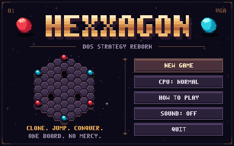
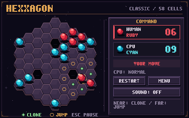

# Hexxagon · VGA Reborn

A complete **Python 3 + Pygame** strategy game inspired by Hexxagon: 58 hexagons,
ruby stones versus cyan stones, three deterministic CPU levels, VGA presentation,
and synthesized retro sound. The code, font, graphics, and audio are original.

**Published by [Garage Zero](https://github.com/garagezerolab).**

**[Download and play on itch.io](https://garagezerolab.itch.io/hexxagon-vga-reborn)**




## Play

Use **Python 3.10-3.13**. The verified setup uses Python 3.13.14, Pygame 2.6.1,
and pytest 9.1.1.

```bash
python -m pip install -r requirements.txt
python main.py
```

On Windows, double-click **play.bat**. It checks for a local `.venv`, then
falls back to `python`. No external assets, accounts, or network connection
are required. If audio is unavailable, the game continues silently.

## Rules and controls

You control the **ruby** stones; the CPU controls **cyan**. You move first.

| Action | Control |
| --- | --- |
| Select a ruby stone | Left click |
| Clone one hex away | Click a green diamond |
| Jump two hexes away | Click a gold ring |
| Cancel selection | Right click or click outside the board |
| Pause / resume | Esc |
| New game / restart | New Game / Restart, or R while playing |
| Start from menu | Enter |
| Choose menu difficulty | CPU button, or 1 / 2 / 3 |
| Instructions | How to Play, or F1 |
| Toggle sound | M |
| Fullscreen | F11 |
| Debug overlay | F3 |
| Quit | Quit, close the window, or Esc from the menu |

A clone keeps its source and adds a stone. A jump clears its source. Every enemy
stone immediately adjacent to the landing cell changes to your color. Jumps may
cross stones or holes: only hex distance matters.

A player with no legal move is skipped automatically. The game ends when the board
is full, one faction is eliminated, or neither faction can move. More stones win;
equal counts draw. Empty cells are not awarded. There is no repetition-draw rule.

## CPU levels

| Level | Strategy |
| --- | --- |
| Easy | Immediate conversion gain and clone preference |
| Normal | Material, mobility, board control, conversions, clone versus jump, and reply risk |
| Hard | Full alpha-beta minimax with move ordering, transposition table, and iterative deepening |

Hard evaluates material, mobility, center control, reachable territory, conversion
opportunities, and exposed stones. Equivalent clone successors are deduplicated;
the search has no artificial beam limit. Search runs in a separate process with a
two-second default budget and four plies. On timeout, Hard uses the last completed
iteration or a legal immediate fallback.

## Configuration

Edit `config.py` for scale, FPS, audio, animation durations, difficulty, search
depth, CPU budget, and debug mode. The internal image is **384x240**, scaled only
by integer factors for crisp pixels.

```bash
python main.py --difficulty Hard --depth 5 --scale 4
python main.py --debug --mute --autostart
```

## Architecture

```text
main.py                    CLI and startup
config.py                  Settings and version
board.py                   Immutable rules and hex geometry
ai.py                      Evaluation and search without Pygame
worker.py                  CPU process and cancellation
game.py                    Input, screens, and animation timing
renderer.py                Bitmap font, pixel art, UI, and animation
audio.py                   In-memory PCM synthesis
tests/                     Rules, AI, controller, process, and audio tests
tools/build_release.py     Reproducible source ZIP and checksum
```

The grid uses axial `(q, r)` coordinates and cube distance. It is a radius-four
hexagon with holes `(0,-2)`, `(-2,2)`, and `(2,0)): **61 - 3 = 58 cells**.
The historical rule reference is the [Hexxagon presentation at Pressibus](https://www.pressibus.org/ataxx/hexx/gbregles.html);
this implementation's orientation, interface, and assets are original.

## Tests and release

```bash
pytest
python main.py --headless --autostart --smoke-frames 5 --screenshot .qa/check.png
python tools/build_release.py
```

The suite covers geometry, moves, conversions, passes, terminal outcomes, AI
equivalence and alpha-beta search, timeouts, process cancellation, controller
input, recovery, and audio. The release script creates
`dist/hexxagon-vga-reborn-1.0.0-source.zip` and its `.sha256` file.

Native Windows and Linux packages can be built with `python tools/build_native.py`
after installing `requirements-build.txt` on the target OS. See [publishing notes](docs/PUBLISHING.md),
[contributing](CONTRIBUTING.md), the [changelog](CHANGELOG.md), and the [MIT license](LICENSE).

